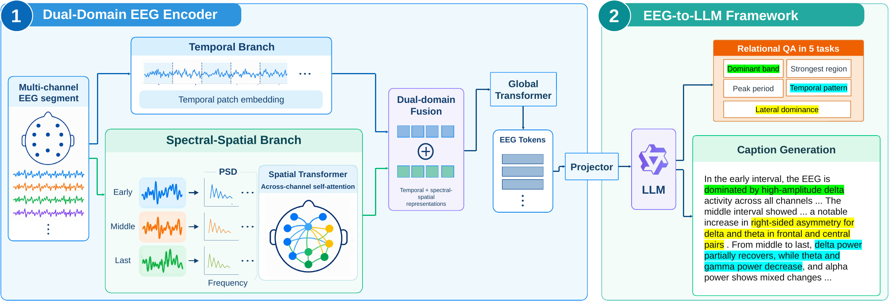

# EEG-Captioner

### Grounding EEG-to-Language Generation in Fundamental Signal Properties

**Leyuan Jin, Jiahao Mei, Yixuan Yuan, Shimeng Li, Mengyue Wu, Yue Ding**

X-LANCE Lab, Shanghai Jiao Tong University · Shanghai Mental Health Center

[](https://huggingface.co/LyJinAoki/EEG-Captioner)
[](LICENSE)

[Overview](#overview) · [Results](#results) · [Quick start](#quick-start) · [Data](#data) · [Training](#training) · [Evaluation](#evaluation)

## Overview

Fluent EEG descriptions do not necessarily reflect an understanding of the underlying signal. **EEG-Captioner** connects EEG waveforms to a language model and trains it to both describe the signal and answer questions about quantitatively measurable EEG properties.

The framework combines:

- **Signal-level supervision:** 25 predefined QA conditions across five property families, paired with feature-grounded captions for 160,781 EEG segments from TUEG v2.0.2.
- **A Dual-Domain EEG Encoder:** parallel temporal-waveform and spectral-spatial branches fuse local dynamics with cross-channel frequency information.
- **Joint QA and caption adaptation:** EEG tokens are projected into Qwen2.5-Omni-7B Thinker, with trainable projector and LoRA adapters supporting both tasks.



This repository provides the main EEG-Captioner pipeline: preprocessing, feature extraction, annotation, dataset preparation, training, inference, and evaluation. The CBraMod/LaBraM comparison implementations are outside this release; neither is required to run EEG-Captioner.

## Results

The manuscript reports the following results with the same frozen, QA-pretrained Dual-Domain encoder and different language-adaptation strategies:

| Language adaptation | QA Macro-BA (%) ↑ | Factual consistency (%) ↑ | ROUGE-L ↑ | BLEU-4 ↑ |
| --- | ---: | ---: | ---: | ---: |
| Caption only | 47.82 | 82.06 | 0.4722 | 0.3124 |
| Signal-level QA only | 86.06 | 44.10 | 0.1470 | 0.0083 |
| **Signal-level QA + caption** | **88.81** | **83.46** | **0.4865** | **0.3302** |

Macro-BA averages balanced accuracy over the 25 QA conditions, equivalently over five equally weighted five-condition families. Factual consistency is an external GPT-based assessment against numerical EEG feature summaries.

These are **paper-reported results**, not results from a fresh run of this release. Historical QA evaluation used a combined validation/test diagnostic set for checkpoint selection. The public recipes instead separate validation and test evaluation. Caption-only and joint adaptation also differ in initialization and training exposure. See [evaluation](#evaluation) and the [reproduction notes](docs/reproduction.md) when interpreting or reproducing these numbers.

## Quick start

### 1. Install

Use Python 3.10 or newer and a working PyTorch installation for your CUDA environment. The commands below assume a Linux shell; the distributed training recipes use `torchrun`.

```bash
git clone https://github.com/lyJinAoki/EEG-Captioner.git
cd EEG-Captioner

python -m venv .venv
source .venv/bin/activate
python -m pip install --upgrade pip
python -m pip install -e '.[llm,preprocess,annotation]'
eeg-captioner --help
```

Dependency ranges are declared in [`pyproject.toml`](pyproject.toml). To recreate the recorded Python 3.10 validation stack, add `-c constraints-tested.txt` to the package installation command. See the [validation record](docs/validation.md) for the tested environment and execution scope.

### 2. Download model weights

The [EEG-Captioner bundle](https://huggingface.co/LyJinAoki/EEG-Captioner) contains the EEG encoder, projector, and LoRA adapter. Download the [Qwen2.5-Omni-7B base model](https://huggingface.co/Qwen/Qwen2.5-Omni-7B) separately; it is not included in the bundle.

```bash
python -m pip install -U huggingface_hub
hf download LyJinAoki/EEG-Captioner --local-dir checkpoints/final
hf download Qwen/Qwen2.5-Omni-7B --local-dir checkpoints/Qwen2.5-Omni-7B
export QWEN_PATH="$PWD/checkpoints/Qwen2.5-Omni-7B"
```

Model loading uses local files. The expected bundle layout is:

```text
checkpoints/final/
├── bundle.json
├── encoder.pt
├── eeg_projector.pt
└── qwen_lora/
```

### 3. Generate a caption or answer a question

Use a preprocessed 10-second EEG segment in the [H5 format](docs/data.md). To convert your TUEG EDF files first:

```bash
eeg-captioner preprocess --edf-root /path/to/tueg/edf \
  --output data/processed --workers 4
```

Replace `example.h5` below with a generated H5 file. `--trial` indexes a recording within that file; `--start-sample` is the segment's starting sample at 200 Hz.

```bash
# Caption generation
eeg-captioner infer \
  --bundle checkpoints/final --qwen-path "$QWEN_PATH" \
  --eeg-h5 data/processed/example.h5 --trial 0 --start-sample 0

# Signal-level question answering
eeg-captioner infer \
  --bundle checkpoints/final --qwen-path "$QWEN_PATH" \
  --eeg-h5 data/processed/example.h5 --trial 0 --start-sample 0 \
  --question 'During the early part of this EEG segment, which frequency band has the highest absolute power in the temporal region? Options: A. delta B. theta C. alpha D. beta E. gamma. Answer with only the option letter and label.'
```

Inputs must be in **microvolts at 200 Hz**. The loader selects the fixed 20-channel order and applies `/100` scaling internally. Only a missing OZ channel may be zero-filled. See [input requirements](docs/data.md) before supplying custom H5 files.

The recorded one-segment inference check used approximately **16.9 GiB** of peak allocated GPU memory on an A100 40 GB. This is an observed compatibility check, not a minimum-memory guarantee; full training has different requirements.

## Data

The paper dataset pairs **160,781 ten-second EEG segments** with feature-grounded captions and valid QA labels. Each segment has 25 candidate questions, filtered for numerical validity and ambiguity, across these families:

| Property family | What the model compares |
| --- | --- |
| Dominant band | Frequency-band power within a fixed time interval and region |
| Strongest region | Regional power within a fixed frequency band and interval |
| Peak period | Early, Middle, and Last intervals for a fixed feature |
| Temporal pattern | How a feature changes across the three intervals |
| Lateral dominance | Left/right activity for a fixed interval and frequency band |

TUEG v2.0.2 recordings must be obtained separately under the corpus access conditions. Recordings and derived patient samples are not included in this repository or the model bundle.

After EDF preprocessing, build the annotations and manifest from the repository root:

```bash
# Prepare source-space template/atlas assets, then extract numerical features.
eeg-captioner source-artifacts --config configs/features.yaml
eeg-captioner features --config configs/features.yaml
eeg-captioner summaries --input-glob 'data/features/*.h5' --output-dir data/summaries

# Generate captions from numerical summaries through your annotation provider.
export EEG_CAPTION_API_KEY='your-key'
eeg-captioner annotate --summaries data/summaries --output data/captions \
  --base-url https://your-provider.example/v1 --model your-deepseek-model-id

# Compute QA labels and create a portable training/evaluation manifest.
eeg-captioner prepare --processed data/processed --summaries data/summaries \
  --captions data/captions --output data/manifest.jsonl
```

The paper uses DeepSeek-V4-Flash for caption annotation. Supply your provider's corresponding model ID and endpoint; the [annotation prompt](src/eeg_captioner/prompts/caption_annotation.txt) is included. The annotation command sends numerical summaries to that endpoint. Existing captions can also be placed in `data/captions` with filenames matching the summary stems.

See [data and preprocessing](docs/data.md) for channel order, QC, feature definitions, manifest schema, and split construction. The split is filename-disjoint and does not guarantee subject-disjoint evaluation. Keep annotation metadata and generated targets, since provider/model changes can affect regenerated captions.

## Training

Set `QWEN_PATH`, prepare `data/manifest.jsonl`, and run the full chain:

```bash
bash scripts/train_chain.sh
```

| Stage | Trainable components | Steps | Configuration |
| --- | --- | ---: | --- |
| Encoder pretraining | Dual-Domain encoder + task-specific query decoders | 30,000 | [Encoder](configs/train_encoder.yaml) |
| QA adaptation | Projector + Qwen LoRA | 30,000 | [QA](configs/train_qa.yaml) |
| Joint QA/caption, caption fraction 0.25 | Projector + Qwen LoRA | 15,000 | [Joint 0.25](configs/train_joint_025.yaml) |
| Joint QA/caption, caption fraction 0.75 | Projector + Qwen LoRA | 15,000 | [Joint 0.75](configs/train_joint_075.yaml) |
| Joint QA/caption, caption fraction 0.90 | Projector + Qwen LoRA | 15,000 | [Joint 0.90](configs/train_joint_090.yaml) |

The EEG encoder and Qwen base weights remain frozen during language adaptation. Each joint stage inherits the previous stage's projector/LoRA weights and starts a new optimizer. Caption fractions specify the share of sampled microbatches; the final stage adds cosine learning-rate decay.

The supplied chain uses one GPU with batch size 48 for encoder training, then two GPUs with microbatch size 1 and gradient accumulation 2 for language adaptation (effective batch size 4). Adjust configurations for your hardware. Individual stages can also be launched directly:

```bash
eeg-captioner train --config configs/train_encoder.yaml
eeg-captioner export-encoder \
  --source runs/encoder/best/model.pt --output checkpoints/encoder.pt
torchrun --standalone --nproc_per_node=2 -m eeg_captioner train \
  --config configs/train_qa.yaml
```

Use a new `output_dir` for each run. To resume the same interrupted stage, add `resume: runs/<run>/last` to its otherwise unchanged YAML. Details on checkpoint selection, optimizer/RNG restoration, and historical weight identity are in [reproduction notes](docs/reproduction.md).

## Evaluation

With the manifest, bundle, and Qwen base model in place:

```bash
eeg-captioner evaluate --config configs/evaluate.yaml
```

[`configs/evaluate.yaml`](configs/evaluate.yaml) evaluates signal-level QA and caption generation on `split: test`. The evaluator reports QA balanced accuracy, ROUGE-L, and corpus BLEU-4.

- **Public protocol:** model selection uses validation data, with test evaluated separately.
- **Historical paper protocol:** QA used a class-balanced diagnostic set of 2,540 questions drawn from validation and test filenames, also used for checkpoint selection. Fresh runs under the public protocol are not directly comparable to those table scores.
- **Factual consistency:** the paper used GPT-5.6 Sol through the ChatGPT web interface. Per-example judgments are not bundled, and the local evaluator does not calculate this score.

The [reproduction notes](docs/reproduction.md) explain metric aggregation, caption sampling, and protocol differences. The [validation record](docs/validation.md) distinguishes synthetic tests and model-loading checks from full-scale reproduction.

## Repository layout

```text
configs/                       Feature, training, and evaluation recipes
scripts/train_chain.sh         End-to-end training and bundle export
src/eeg_captioner/
├── preprocessing/             TUEG EDF to subject H5
├── features/                  Numerical features and summaries
├── data/                      Manifest, QA rules, thresholds, sampling
├── models/                    Encoder, query heads, projector, Qwen interface
├── training/                  Classifier and distributed language training
├── evaluation/                QA and caption metrics
└── prompts/                   Caption annotation instructions
tests/                         Numerical, data, and language checks
docs/                          Data, reproduction, provenance, validation
```

For development checks:

```bash
python -m pip install -e '.[llm,preprocess,annotation,dev]'
pytest -q
```

To export your own trained checkpoints into the inference bundle format:

```bash
eeg-captioner export --encoder runs/encoder/best/model.pt \
  --adapter runs/joint_090/final --output checkpoints/final
```

Export only trusted research checkpoints: migration reads their Python metadata. Portable encoders are loaded with `weights_only=True` and strict state-dictionary matching. See [export details](docs/reproduction.md#export).

## Citation

To cite this code release:

```bibtex
@misc{jin_eeg_captioner,
  title        = {EEG-Captioner: Grounding EEG-to-Language Generation in Fundamental Signal Properties},
  author       = {Jin, Leyuan and Mei, Jiahao and Yuan, Yixuan and Li, Shimeng and Wu, Mengyue and Ding, Yue},
  howpublished = {Research code},
  url          = {https://github.com/lyJinAoki/EEG-Captioner}
}
```

## License and acknowledgments

Source code is released under the [MIT License](LICENSE). TUEG data, Qwen weights, and MNE template/atlas assets retain their respective upstream terms; see [NOTICE](NOTICE). We thank the developers and maintainers of these resources.
